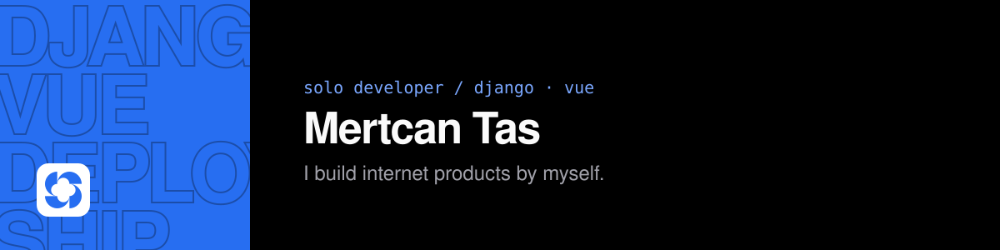
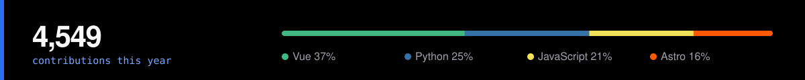

I build internet products alone — no investors, no team. Mostly **Django** and **Vue**: REST APIs, background jobs, real-time features and the automation around them. Lately also AI-powered tools.

**[Blog](https://mertcan-tas.github.io)** · **[Email](mailto:mertcan.tas@outlook.com)** · **[RSS](https://mertcan-tas.github.io/rss.xml)**

**Recent writing**

 
 
 

